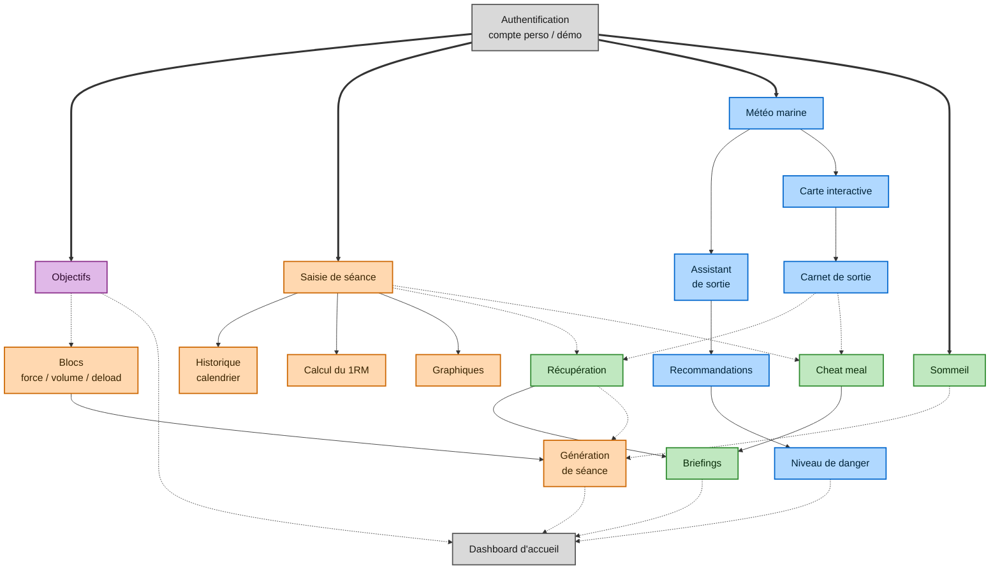

---
tags:
  - cdc
statut: brouillon
---

# Croisements entre modules

← [[00 - Sommaire|Sommaire]]

> [!abstract] Pourquoi cette note
> C'est ici que le projet se distingue : aucune donnée ne reste dans son coin. Cette note sert de référence pour le [[09 - Modèle de données|modèle de données]] et pour les [[10 - Architecture technique#Moteurs de règles|moteurs de règles]].

## Légende
| Couleur | Espace |
|---|---|
| 🟧 | Streetlifting |
| 🟦 | Marine |
| 🟩 | Vie courante |
| 🟪 | Objectifs |
| ⬜ | Transversal |

**Trait plein** = enchaînement à l'intérieur d'un espace · **Pointillé** = croisement entre deux espaces · **Trait épais** = accès donné par l'authentification

## Diagramme

> [!info] Pour garder le schéma lisible
> Deux flux ne figurent que dans le tableau ci-dessous : **1RM → Objectifs** et **Récupération → Assistant de sortie**.

## Tableau des flux
| Source | Donnée transmise | Destination | Effet |
|---|---|---|---|
| Saisie de séance | RPE, type de séance | Récupération | Calcule le temps de récupération nécessaire |
| Saisie de séance | Volume, intensité | Cheat meal | Pèse dans le verdict « écart mérité » |
| Carnet de sortie | Type, durée, température de l'eau | Récupération | Ajoute la fatigue d'une sortie |
| Carnet de sortie | Type, durée, température de l'eau | Cheat meal | Une sortie en eau froide compte comme un effort |
| Suivi du sommeil | Heures dormies | Génération de séance | Allège la séance ou reporte un max |
| Récupération | État de récupération | Génération de séance | Ajuste l'intensité proposée |
| Récupération | Besoin de récup active | Assistant de sortie | Propose une baignade de récupération |
| Objectifs | Cible, date, blocs | Blocs du calendrier | Structure la programmation |
| Calcul du 1RM | 1RM estimé | Objectifs | Calcule la progression vers la cible |
| Tous les espaces | Synthèses | Briefings et dashboard d'accueil | Vue d'ensemble du jour, de la semaine, du bloc |
