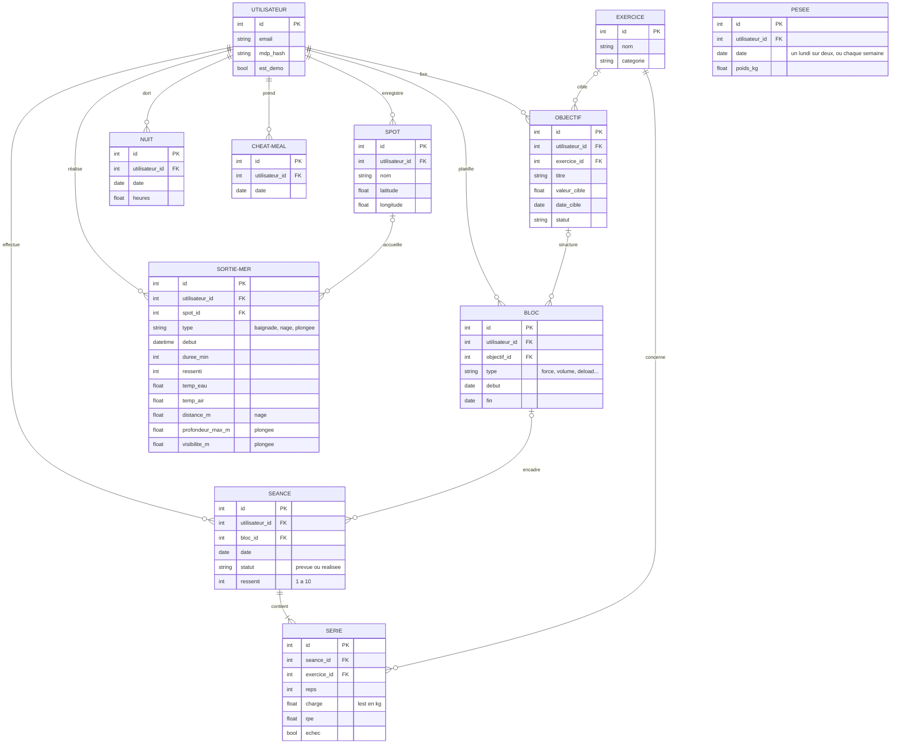

---
tags:
  - cdc
statut: brouillon
---

# Modèle de données (ébauche)

← [[00 - Sommaire|Sommaire]] · [[08 - Croisements entre modules|Croisements]]

> [!abstract] Statut
> Première ébauche : les tables principales, leurs liens et quelques champs clés. Les champs définitifs viendront au moment de coder chaque espace.

## Diagramme

## Stocké ou calculé
**Stocké en base :** ce que je saisis — séances, séries, blocs, objectifs, sorties, spots, nuits, cheat meals.

**Calculé à la demande** par les moteurs de règles, jamais stocké en V1 : 1RM estimé, état de récupération, verdict cheat meal, niveau de danger, recommandations, briefings.

> [!tip] Pourquoi
> Une valeur calculée ne peut pas devenir fausse ou périmée : elle est toujours recalculée à partir des vraies données.

## Choix déjà faits dans cette ébauche
- **`utilisateur_id` sur chaque table** : base multi-utilisateurs dès le départ (mode démo, ouverture future).
- 💡 **Séance « prévue » puis « réalisée »** : la séance générée est enregistrée comme prévue, puis complétée — ce qui permet d'afficher prévu vs réalisé.
- **Pesée hebdomadaire (table `PESEE`), pas de poids sur la séance** : le poids du corps change, donc il se lit à la date de la séance. Si aucune pesée n'existe, on reprend la dernière connue et on l'affiche comme « non mise à jour ». Le 1RM se calcule sur une moyenne mobile de 2 à 3 semaines, jamais stockée.
- **Champs propres à chaque type de sortie en colonnes optionnelles** : plus simple en V1 ; à revoir si le carnet de plongée s'enrichit beaucoup.
- **Exercices** : une liste commune, pré-remplie (tractions, dips, muscle-up…).

## ❓ À trancher
- Programme type d'un bloc : quelle table porte la structure de base des séances ? (cf. [[13 - Décisions et questions ouvertes|Questions ouvertes]])
- Conditions météo d'une sortie : quelques colonnes suffisent-elles, ou faut-il un relevé complet ?
