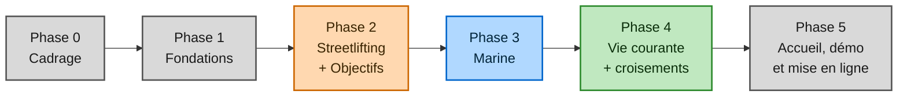

---
tags:
  - cdc
statut: brouillon
---

# Roadmap et estimation

← [[00 - Sommaire|Sommaire]]

> [!info] Comment lire cette note
> Les phases se suivent dans l'ordre. Le design de chaque espace se fait **avec** son espace ; la passe de finition globale arrive en phase 5. Coche les cases au fil de l'eau.

## Phase 0 — Cadrage *(15–25 h)*
- [ ] Finaliser ce cahier des charges
- [ ] Trouver le nom du projet
- [ ] Créer le repo GitHub, protéger `main`
- [ ] Rechercher et tester les API externes (météo, météo marine, marées)
- [ ] Moodboards de chaque espace

## Phase 1 — Fondations *(20–30 h)*
- [ ] Arborescence backend + frontend
- [ ] Base de données et premières tables
- [ ] Authentification : compte perso + compte démo
- [ ] Coquille de navigation : accueil + quatre espaces vides, transitions
- [ ] Tag `v0.1.0`

## Phase 2 — Streetlifting + Objectifs *(75–105 h)*
- [ ] Saisie d'une séance
- [ ] Historique via calendrier
- [ ] Blocs d'entraînement
- [ ] Objectifs
- [ ] Calcul du 1RM estimé
- [ ] Graphiques d'évolution
- [ ] Moteur d'auto-régulation + génération de séance
- [ ] Identité visuelle de l'espace

> [!tip] Pourquoi commencer par là
> C'est l'espace que j'utiliserai tous les jours : dès qu'il fonctionne, j'accumule de vraies données, indispensables pour tester les croisements plus tard.

## Phase 3 — Marine *(70–90 h)*
- [ ] Prototype isolé de la carte ⚠️ (peut être avancé pour lever le risque tôt)
- [ ] Services API externes + cache
- [ ] Dashboard météo marine
- [ ] Carnet de sortie (trois modes)
- [ ] Assistant de sortie + recommandations
- [ ] Niveau de danger
- [ ] Carte interactive intégrée
- [ ] Identité visuelle de l'espace

## Phase 4 — Vie courante + croisements *(55–85 h)*
- [ ] Suivi du sommeil
- [ ] Gestionnaire de récupération
- [ ] Gestionnaire de cheat meal
- [ ] Brancher sommeil et récupération sur la génération de séance
- [ ] Brancher la récupération sur l'assistant de sortie
- [ ] Briefings
- [ ] Identité visuelle de l'espace

## Phase 5 — Accueil, démo et mise en ligne *(15–25 h)*
- [ ] Dashboard d'accueil complet + animation d'entrée
- [ ] Données fictives du mode démo
- [ ] Passe de finition du design
- [ ] Migration PostgreSQL + mise en ligne
- [ ] README portfolio, journal, heures
- [ ] Tag `v1.0.0` 🎉

## Estimation
| Phase | Estimation |
|---|---|
| 0 — Cadrage | 15–25 h |
| 1 — Fondations | 20–30 h |
| 2 — Streetlifting + Objectifs | 75–105 h |
| 3 — Marine | 70–90 h |
| 4 — Vie courante + croisements | 55–85 h |
| 5 — Accueil, démo, mise en ligne | 15–25 h |
| Design (réparti dans les phases, compté à part) | 50–80 h |
| **Total** | **≈ 300–440 h** |

> [!warning] Enveloppe retenue : ~500 h
> Le site tableaux a dépassé son estimation initiale d'un facteur 2 (apprentissage + périmètre qui a grandi en route). Le cadrage en amont devrait réduire l'écart, mais 500 h reste une enveloppe, pas une promesse.
