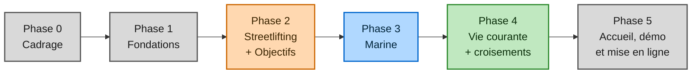

---
tags:
  - cdc
statut: brouillon
---

# Roadmap et estimation

← [[00 - Sommaire|Sommaire]]

> [!info] Comment lire cette note
> Les phases se suivent dans l'ordre. Le design de chaque espace se fait **avec** son espace ; la passe de finition globale arrive en phase 5. Coche les cases au fil de l'eau.

## Phase 0 — Cadrage *(15–25 h)*
- [x] Finaliser ce cahier des charges
- [x] Trouver le nom du projet → **Oh Hisse !**
- [x] Créer le repo GitHub, protéger `main`
- [x] Rechercher et tester les API externes (météo, météo marine, marées) → [`docs/recherche/api-externes.md`](../recherche/api-externes.md)
- [ ] Moodboards de chaque espace *(faits avec chaque espace, au moment de son identité visuelle)*

## Phase 1 — Fondations *(20–30 h)*
- [x] Arborescence backend + frontend
- [x] Base de données et premières tables (Alembic dès le départ)
- [x] Authentification : compte perso + compte démo (bac à sable par visiteur)
- [x] Coquille de navigation : accueil + quatre espaces vides, transitions
- [x] Tag `v0.1.0`

## Phase 2 — Streetlifting + Objectifs *(75–105 h)*
- [x] Saisie d'une séance
- [x] Historique via calendrier
- [x] Blocs d'entraînement (import JSON)
- [x] Objectifs
- [x] Calcul du 1RM estimé (formule RPE, poids du corps + lest)
- [x] Graphiques d'évolution
- [x] Moteur d'auto-régulation + génération de séance
- [x] Identité visuelle de l'espace
- [x] Tag `v0.2.0`

> [!tip] Pourquoi commencer par là
> C'est l'espace que j'utiliserai tous les jours : dès qu'il fonctionne, j'accumule de vraies données, indispensables pour tester les croisements plus tard.

## Phase 3 — Marine *(70–90 h)*
- [x] ~~Prototype isolé de la carte~~ : carte intégrée directement (MapLibre), le risque portait sur le trait de côte selon la marée
- [x] Services API externes + cache (repli sur la dernière réponse si Open-Meteo tombe)
- [x] Dashboard météo marine
- [x] Carnet de sortie (trois modes, conditions relevées automatiquement)
- [x] Assistant de sortie + recommandations
- [x] Niveau de danger
- [x] Carte interactive intégrée (spots, eau, vent, courant, tracé de nage)
- [x] Trait de côte et distance jusqu'à l'eau selon la marée : relevés Litto3D intégrés en phase 5
- [x] Identité visuelle de l'espace
- [x] Tag `v0.3.0`

## Phase 4 — Vie courante + croisements *(55–85 h)*
- [x] Suivi du sommeil
- [x] Gestionnaire de récupération
- [x] Gestionnaire de cheat meal
- [x] Brancher sommeil et récupération sur la génération de séance
- [x] Brancher la récupération sur l'assistant de sortie
- [x] Briefings (jour, semaine, début et fin de bloc)
- [x] Identité visuelle de l'espace
- [x] Tag `v0.4.0`

## Phase 5 — Accueil, démo et mise en ligne *(15–25 h)*
- [x] Dashboard d'accueil complet + animation d'entrée
- [x] Données fictives du mode démo
- [ ] Passe de finition du design
- [x] Migration PostgreSQL (vérifiée en CI) et image prête pour Render + Neon
- [ ] Mise en ligne (comptes Render et Neon à créer, cf. `docs/DEPLOIEMENT.md`)
- [ ] README portfolio, journal, heures
- [x] Tag `v0.5.0` : prêt pour la mise en ligne
- [ ] Tag `v1.0.0` 🎉

## Estimation
| Phase | Estimation |
|---|---|
| 0 — Cadrage | 15–25 h |
| 1 — Fondations | 20–30 h |
| 2 — Streetlifting + Objectifs | 75–105 h |
| 3 — Marine | 70–90 h |
| 4 — Vie courante + croisements | 55–85 h |
| 5 — Accueil, démo, mise en ligne | 15–25 h |
| Design (réparti dans les phases, compté à part) | 50–80 h |
| **Total** | **≈ 300–440 h** |

> [!warning] Enveloppe retenue : ~500 h
> Le site tableaux a dépassé son estimation initiale d'un facteur 2 (apprentissage + périmètre qui a grandi en route). Le cadrage en amont devrait réduire l'écart, mais 500 h reste une enveloppe, pas une promesse.
